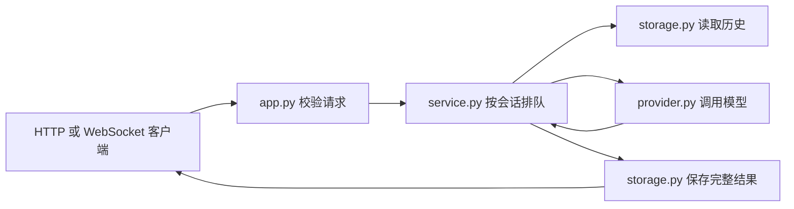

# ydd_python_gateway_origion

一个使用 Python 编写的 Agent Gateway 基础项目，侧重代码易读和流程清晰。它用 FastAPI 提供 HTTP、WebSocket 接口，用 SQLite 保存 Agent、会话、消息和运行结果。

项目目录：`D:\Document\gateway\python_issue\ydd_python_gateway_origion`。

默认使用无需密钥的演示模式：收到问题后回显文本，方便验证整条调用链。演示模式没有模型推理能力。配置兼容 OpenAI Chat Completions 的模型服务后，可以进行真实的多轮对话。

## 文档导航

| 文档 | 内容 | 什么时候看 |
| --- | --- | --- |
| 本文 | 安装、启动、使用、配置、排错 | 第一次跑起来 |
| [docs/architecture.md](docs/architecture.md) | 分层、请求时序、并发与事务、数据模型、错误模型、可靠性、容量 | 想知道内部怎么运转 |
| [docs/api.md](docs/api.md) | HTTP 端点、WebSocket 协议、事件字段、错误码全表、契约稳定性 | 写客户端 / 对接联调 |
| [docs/design-decisions.md](docs/design-decisions.md) | 关键取舍（ADR）与"不做什么" | 准备改架构或质疑某个设计 |
| [docs/development.md](docs/development.md) | 代码地图、测试组织、扩展步骤、调试手法、提交清单 | 要改代码 |
| [docs/proposals/](docs/proposals/README.md) | 尚未落地的设计提案（健康检查、Cookie SSO、粘性会话、非 HTTP 协议） | 规划下一步 |

## 1. 安装并启动

需要 Python 3.11 或更高版本。第一次安装依赖需要联网。在 PowerShell 中运行：

```powershell
cd D:\Document\gateway\python_issue\ydd_python_gateway_origion
python -m venv .venv
.\.venv\Scripts\python.exe -m pip install -r requirements.txt
Copy-Item .env.example .env
.\.venv\Scripts\python.exe run.py
```

如果已经有 `.env`，保留现有文件即可。上面的命令直接使用虚拟环境中的 Python，不需要运行激活脚本。

启动后打开：

- 浏览器聊天页：<http://127.0.0.1:8000/>
- 健康检查：<http://127.0.0.1:8000/health>
- 交互式 HTTP 接口文档：<http://127.0.0.1:8000/docs>

首次启动会自动创建 `data/gateway.sqlite3`，并创建编号为 `default` 的默认助手。按 `Ctrl+C` 停止服务。

## 2. 运行调用示例

保持服务终端运行，另开一个 PowerShell 终端：

```powershell
cd D:\Document\gateway\python_issue\ydd_python_gateway_origion
.\.venv\Scripts\python.exe examples\http_client.py "你好"
.\.venv\Scripts\python.exe examples\websocket_client.py "请解释什么是 Gateway"
.\.venv\Scripts\python.exe examples\manage_client.py
```

HTTP 示例创建会话、发送消息并读取历史。WebSocket 示例创建会话、发送消息并逐块显示结果。管理示例演示改名、清空历史和删除，运行结束会自己清理创建的数据。前两个脚本都会打印会话编号和请求编号，方便查询运行状态。

本机已经准备好一个虚拟环境，位于 `D:\Document\gateway\python_issue\ydd-python-gateway-venv`，也可以直接用它的解释器运行，例如 `& "D:\Document\gateway\python_issue\ydd-python-gateway-venv\Scripts\python.exe" run.py`，不必再执行上面的创建步骤。

示例默认从项目 `.env` 读取 `GATEWAY_TOKEN`，也接受 `--base-url` 和 `--token`：

```powershell
.\.venv\Scripts\python.exe run.py --port 8001
# 在另一个终端运行：
.\.venv\Scripts\python.exe examples\http_client.py --base-url http://127.0.0.1:8001
```

## 3. 接入真实模型

编辑项目根目录的 `.env`：

```dotenv
GATEWAY_PROVIDER=openai
MODEL_BASE_URL=https://api.openai.com/v1
MODEL_API_KEY=填写你的服务商密钥
MODEL_NAME=填写服务商支持的模型名称
MODEL_TIMEOUT_SECONDS=60
MODEL_MAX_TOKENS=2048
MODEL_CONTEXT_TOKENS=8192
```

`MODEL_BASE_URL` 填接口前缀，程序自动追加 `/chat/completions`。接入其他兼容服务时，按服务商说明填写地址、模型名称和密钥。本地无密钥模型服务可以留空 `MODEL_API_KEY`。`MODEL_CONTEXT_TOKENS` 填服务商给出的上下文窗口大小；填小了会提前省略历史，填大了会在超限时收到上游的 400/502。

保存后重启 Gateway，再运行调用示例。默认助手会在启动时使用当前 `MODEL_NAME`；自建 Agent 保留创建时指定的模型。模型配置是整个 Gateway 共用的服务地址和密钥，不支持为不同 Agent 配置不同服务商。

上游必须支持文本 Chat Completions 流式响应，并以 `finish_reason: "stop"` 和 `[DONE]` 明确结束。仅提供 Responses API、工具调用或非标准流式格式的服务需要另写适配器。真实模型调用的费用由所配置的服务商决定。

## 4. 主要概念与调用流程

| 概念 | 本项目中的含义 |
| --- | --- |
| Agent | 助手配置，包括名称、系统提示词和模型名称 |
| Session | 会话，创建时绑定一个 Agent，保存连续的聊天历史 |
| Message | 用户或助手的一条消息 |
| Run | 对一条用户输入的处理记录，带运行状态、结果或错误 |
| request_id | 客户端为一次提问分配的编号，用于查询和避免重复生成 |



同一会话中的请求依次执行，前一轮保存后，后一轮才读取历史。不同会话可以同时调用模型。HTTP 和 WebSocket 共享这套处理逻辑。

### 上下文预算与裁剪

模型的上下文窗口有限，"系统提示词 + 全部历史 + 当前提问"迟早会放不下，上游只会返回一个含糊的 400/502。所以每次请求都会先按预算裁剪：

```text
可用预算 = MODEL_CONTEXT_TOKENS − MODEL_MAX_TOKENS − 128（固定余量）
```

- **估算方式**：中文等宽字符按 1 字约 1 token，其他字符按 3 个约 1 token，每条消息再加 4 个 token 的框架开销。这是故意偏保守的估算：估少了会重新超限，估多了只是少带一点历史。
- **丢弃单位是"一问一答"**：从最旧的一轮开始整对丢弃，保留下来的历史仍然严格交替，不会出现"助手消息开头"这类被上游拒绝的形状。
- **丢弃后会补一句提示**：插在系统提示词后面，形如"（较早的 4 条对话已省略，以适配模型上下文。）"，让模型知道自己缺了前文。
- **绝不截断当前提问**：如果连"系统提示词 + 当前提问"都超出预算，直接返回 `413 context_too_large`，并提示你缩短输入或调大 `MODEL_CONTEXT_TOKENS`。这种情况下不会写运行记录，也不会调用模型，改短输入后可以用同一个 `request_id` 重试。
- **数据库不受影响**：裁剪只改变这一次发给模型的内容，`GET /sessions/{id}/messages` 仍然返回全部历史。

每次实际调用模型时，`start` 和 `done` 事件都会带上裁剪结果：

```json
{"context": {"trimmed_messages": 4, "estimated_tokens": 5200, "budget_tokens": 5888}}
```

`trimmed_messages` 是本次被省略的历史消息条数（0 表示全部保留）。命中 `request_id` 的重放不会调用模型，因此不带 `context`。

## 5. HTTP 接口

除健康检查和接口文档外，设置 `GATEWAY_TOKEN` 后，所有业务接口都需要请求头：

```text
Authorization: Bearer 你设置的GatewayToken
```

| 方法 | 路径 | 用途 |
| --- | --- | --- |
| GET | `/health` | 查看服务是否运行及当前模式 |
| GET | `/agents` | 列出 Agent，可传 `limit`、`offset` |
| POST | `/agents` | 创建 Agent |
| PATCH | `/agents/{agent_id}` | 修改 Agent 的名称、系统提示词或模型 |
| DELETE | `/agents/{agent_id}` | 删除没有会话的 Agent |
| GET | `/sessions` | 列出会话，可传 `limit`、`offset` |
| POST | `/sessions` | 创建会话 |
| GET | `/sessions/{session_id}` | 查看会话及关联 Agent 配置 |
| PATCH | `/sessions/{session_id}` | 重命名会话 |
| DELETE | `/sessions/{session_id}` | 删除会话及其消息、运行记录 |
| GET | `/sessions/{session_id}/messages` | 按顺序读取消息，包含各消息对应的运行状态 |
| DELETE | `/sessions/{session_id}/messages` | 清空会话历史，返回删除条数 |
| POST | `/sessions/{session_id}/ticket` | 换取连接 WebSocket 的一次性票据（浏览器用） |
| POST | `/sessions/{session_id}/chat` | 提问，等待完整回答 |
| GET | `/sessions/{session_id}/requests/{request_id}` | 用客户端请求编号查询运行记录 |
| GET | `/runs/{run_id}` | 用运行编号查询运行记录 |

创建 Agent 的请求体：

```json
{
  "name": "Python 学习助手",
  "system_prompt": "请用简单易懂的中文解释 Python，并给出小例子。"
}
```

省略 `model` 时使用当前 `MODEL_NAME`。修改 Agent 时只提交要改的字段，`PATCH` 请求体为空会被拒绝：

```json
{"name": "新的助手名称", "model": "另一个模型名称"}
```

创建会话的请求体：

```json
{"agent_id": "default", "title": "第一次对话"}
```

`agent_id`、`title` 都可以省略，但请求体仍需传 `{}`。使用返回的会话 `id` 调用聊天接口：

```json
{"content": "你好", "request_id": "question-001"}
```

演示模式成功响应示例：

```json
{
  "type": "done",
  "session_id": "实际会话编号",
  "request_id": "question-001",
  "run_id": "实际运行编号",
  "reply": "[演示模式] 收到：你好",
  "replayed": false,
  "context": {"trimmed_messages": 0, "estimated_tokens": 42, "budget_tokens": 6016}
}
```

客户端可以省略 `request_id`，让服务端生成；需要在网络重试时复用结果的客户端应主动生成并保存它。`content` 为去除首尾空白后非空的文本，最多 32,000 个字符；`request_id` 最多 100 个字符。

### 管理与分页

删除和清空只在会话空闲时执行：会话里存在 `running` 记录时返回 `409 session_busy`，这样就不会删掉正在写入的轮次。等这一轮结束，或先用请求编号查到最终状态，再执行删除。

- 删除 Agent 前要先删除它的会话，否则返回 `409 agent_in_use`。编号为 `default` 的默认助手由服务自动创建，不能删除。
- 修改默认助手的 `name` 和 `system_prompt` 会一直保留；它的 `model` 在下次启动时仍会跟随 `MODEL_NAME`。
- 清空历史会同时删除运行记录，因此旧 `request_id` 之后可以重新使用，不会被判为重放或冲突。
- 列表接口默认返回前 100 个 Agent、前 100 个会话和前 1000 条消息，用 `limit` 和 `offset` 翻页。`limit` 取值范围：Agent 和会话是 `1` 到 `1000`，消息是 `1` 到 `5000`；`offset` 从 `0` 开始。消息按写入顺序（最早的在前）返回，所以 `offset` 越大，取到的内容越新。

## 6. WebSocket 流式接口

连接地址：`ws://127.0.0.1:8000/sessions/{session_id}/stream`。会话必须先通过 HTTP 创建。设置 token 后有两种准入方式：能在握手时写信头的客户端（如 Python 示例）直接携带 `Authorization`；浏览器则用一次性票据 `?ticket=...`，见下面的"票据与浏览器聊天页"。

连接后发送一条 JSON 文本：

```json
{"content": "你好", "request_id": "question-002"}
```

服务端依次返回事件：

| type | 关键字段 | 含义 |
| --- | --- | --- |
| `start` | `session_id`、`request_id`、`run_id`、`context` | 本轮已开始，并保存了用户输入 |
| `delta` | `content` | 新增文本，需要追加显示 |
| `done` | `reply`、`replayed`、`context` | 完整回答已经保存 |
| `error` | `status`、`error.code`、`error.message` | 本轮失败；已收到的部分文本不算完整结果 |

所有 `error` 事件形状统一：`{"type": "error", "status": 502, "session_id": ..., "request_id": ..., "run_id": ..., "error": {"code": ..., "message": ...}}`，其中请求还没落地时 `request_id` / `run_id` 会省略。HTTP 接口的错误体同样是 `{"error": {"code", "message"}}`，会话/请求/运行编号放在外层。

`delta.content` 是增量片段，`done.reply` 是完整回答，两者不要重复拼接。成功请求重放时只返回 `done`，其中 `replayed` 为 `true`。

一个连接可以连续提问，建议收到上一轮 `done` 或 `error` 后再发下一条。服务器每个连接最多保留 8 条待处理消息；超出会关闭连接。WebSocket 文本帧上限为 64 KiB。

Python 示例使用握手头鉴权；浏览器用不了请求头，走下面的"票据与浏览器聊天页"。

### 票据与浏览器聊天页

浏览器原生的 `WebSocket` API 不能设置 `Authorization` 头。为此网关提供了一条替代路径：

1. 页面用普通 HTTP 请求携带 token 换取票据：`POST /sessions/{session_id}/ticket`；
2. 再用 `ws://.../sessions/{session_id}/stream?ticket=票据` 建立连接。

票据的规则：

- **一次性**：连接时取出即作废，重连必须重新取票。校验失败也会作废，多试不会提高成功率。
- **绑定会话**：A 会话的票据连不上 B 会话，用错会话同样会作废这张票据。
- **30 秒有效**：只需要撑过"取票到连上"，见 `gateway/tickets.py` 的 `TICKET_SECONDS`。
- **只存在内存**：服务重启后全部失效，页面重新取一张即可；也因此不要开启多 worker。

票据会出现在 WebSocket 地址的查询串里，可能被访问日志记录下来。因为一次性且有效期很短，泄露窗口有限；如果日志会长期留存或外发，应换用 TLS 反向代理并收紧日志。

启动 Gateway 后直接打开 <http://127.0.0.1:8000/> 即可使用内置聊天页。页面不需要额外的静态服务器，也不含任何密钥：

- `/` 和 `/health` 不需要 token，所以页面能先加载；`/health` 会返回 `auth_required`，页面据此提示是否要填 token。
- 需要鉴权时，在页面顶部填入 `GATEWAY_TOKEN` 并保存，token 存在浏览器 `localStorage`，只用于向同源接口发请求。
- 页面会复用已保存的会话，服务端数据被清理过时自动新建；"新会话"按钮会换一个新的会话编号。
- 模型的流式输出用 `textContent` 写入页面，不会被当作 HTML 解析。
- 每条消息取一张新票据并新开一条连接，所以刷新页面或中途断开都不会留下"半张"票据。

在共享机器上使用浏览器页面时，`localStorage` 里的 token 对本机其他用户可见；只在本机演示时建议保持 `GATEWAY_TOKEN` 为空并只监听 `127.0.0.1`。

## 7. 保存、失败和重试

Agent、会话、消息和运行记录均保存在 SQLite。成功后，助手消息和 `completed` 状态在同一个事务中提交，然后才返回 `done`。

运行状态包括 `running`、`completed`、`failed` 和 `interrupted`：

- 模型报错、超时、空回答或流提前结束时，运行标记为失败，保存可读错误。
- 失败或中断时保留用户输入；部分助手文本不写入历史。下一轮模型上下文只包含已成功完成的问答。
- WebSocket 断开会取消该连接正在处理的轮次，并丢弃该连接尚未开始的排队消息。如果结果已提交，则仍为成功，可以查询记录取回。
- HTTP 客户端断开后，服务端可能继续完成本轮。先查询 `/sessions/{session_id}/requests/{request_id}`，不要直接换编号重发。
- 服务重启后，旧的 `running` 记录会标记为 `interrupted`，不会自动恢复生成。

同一会话中，相同 `request_id` 和相同文本的成功请求会直接返回已有答案，不再调用模型。相同编号用于不同内容，或用于已有失败、中断记录，会返回 `409`。确认需要重新生成后，使用新的 `request_id`。

这种去重依赖已保存的运行记录。它不承诺外部模型调用在崩溃或网络不确定情况下绝对只执行一次，也不会自动重试模型请求。

| 常见情况 | 处理方式 |
| --- | --- |
| `401 unauthorized` | 检查 Gateway token，注意它和模型 API key 是两个不同配置 |
| `404` | 检查 Agent、会话、请求或运行编号是否存在 |
| `409` | 按错误码区分：`request_conflict` 或 `request_not_completed` 表示该 `request_id` 需要换新的；`session_busy` 表示会话正在生成，等结束后再删改；`agent_in_use` 表示 Agent 还有会话；`default_agent` 表示默认助手不能删除 |
| `422 invalid_request` | 对照 `/docs` 检查字段、类型及长度 |
| WebSocket 握手被拒（`1008`） | token 不对，或票据已过期、已用过、不属于这个会话；浏览器里刷新页面即可重新取票 |
| `413 context_too_large` | 这次提问连系统提示词就超出上下文预算；缩短输入，或调大 `MODEL_CONTEXT_TOKENS` 后重启 |
| 模型返回 `502` 或 `503` | 根据错误说明检查模型服务地址、名称、权限或额度 |
| 本机模型返回 `502 model_connection_error` | 模型服务在 `127.0.0.1` 且电脑开着代理软件时，请求会被代理拦截；确认 `MODEL_USE_SYSTEM_PROXY=false` 后重启 |
| `504 model_timeout` | 检查模型服务，或调整 `MODEL_TIMEOUT_SECONDS` 后重启 |
| 端口已占用 | 使用 `python run.py --port 8001`，客户端也改用对应端口 |

## 8. 配置参考

配置从项目根目录 `.env` 加载。已经设置的系统环境变量优先；修改后需重启服务。

| 环境变量 | 默认值 | 含义 |
| --- | --- | --- |
| `GATEWAY_PROVIDER` | `demo` | `demo` 回显；`openai` 调用兼容服务 |
| `GATEWAY_TOKEN` | 空 | Gateway 共享访问 token；空值适合本机演示 |
| `GATEWAY_DB_PATH` | `data/gateway.sqlite3` | 数据库路径，相对路径以项目根目录为基准 |
| `MODEL_BASE_URL` | `https://api.openai.com/v1` | 模型 API 前缀 |
| `MODEL_API_KEY` | 空 | 模型服务的访问密钥 |
| `MODEL_NAME` | `demo` | 真实模式必须填写服务商支持的模型名称 |
| `MODEL_TIMEOUT_SECONDS` | `60` | 模型网络读写和整轮生成的超时秒数；不包含会话排队等待 |
| `MODEL_MAX_TOKENS` | `2048` | 传给模型的 `max_tokens` 输出上限 |
| `MODEL_CONTEXT_TOKENS` | `8192` | 模型上下文窗口总长度（提示词 + 回答）；历史按它裁剪，必须比 `MODEL_MAX_TOKENS` 至少大 256 |
| `MODEL_USE_SYSTEM_PROXY` | `false` | 是否让模型请求走系统代理。访问本机或内网模型服务时必须保持 `false`；只有需要经代理访问远程服务时才设为 `true` |
| `GATEWAY_ROUTES_PATH` | `routes.json` | 反向代理路由表位置，相对路径以项目根目录为基准；文件不存在表示不启用 |
| `GATEWAY_PROXY_TIMEOUT` | `30` | 反向代理访问上游的超时秒数（独立于模型超时） |
| `GATEWAY_LOG_ENABLED` | `true` | 是否启用结构化日志 |
| `GATEWAY_LOG_DIR` | `D:\Document\logs\ydd-gateway` | 日志根目录；按类别与被代理服务分子目录 |
| `GATEWAY_LOG_LEVEL` | `INFO` | 日志级别 |
| `GATEWAY_LOG_STDOUT` | `false` | 是否同时输出到标准输出（容器采集时打开） |
| `GATEWAY_LOG_PARAMS` | `true` | 是否记录请求参数（query / JSON body） |
| `GATEWAY_LOG_CONTENT_PREVIEW` | `200` | 字符串参数保留的字符数；`0` 表示只记长度 |
| `GATEWAY_LOG_PARAM_MAX_BYTES` | `65536` | 单个请求体最多读取多少字节用于日志 |
| `GATEWAY_LOG_MAX_BYTES` | `52428800` | 单个日志文件大小上限，超出后追加序号 |
| `GATEWAY_LOG_BACKUP_DAYS` | `30` | 普通日志保留天数 |
| `GATEWAY_AUDIT_BACKUP_DAYS` | `180` | 审计日志保留天数 |
| `GATEWAY_AUTH_MODE` | `legacy` | `legacy` 只认共享 token；`local` 启用本地账号 + 会话 Cookie |
| `GATEWAY_SESSION_IDLE_SECONDS` | `28800` | 会话空闲过期时间 |
| `GATEWAY_SESSION_ABSOLUTE_SECONDS` | `604800` | 会话绝对过期时间 |
| `GATEWAY_COOKIE_SECURE` | `false` | 走 HTTPS 时设为 `true`（Cookie 加 `Secure`） |
| `GATEWAY_LOGIN_MAX_FAILURES` | `5` | 同 IP+账号连续失败多少次后锁定 |
| `GATEWAY_LOGIN_WINDOW_SECONDS` | `300` | 失败计数窗口 |
| `GATEWAY_LOGIN_LOCK_SECONDS` | `900` | 锁定时长 |

`run.py` 默认只监听 `127.0.0.1:8000`。需要局域网访问时，先设置非空 `GATEWAY_TOKEN`，再运行 `python run.py --host 0.0.0.0`；跨不可信网络应通过 HTTPS/WSS 反向代理或受保护的隧道访问。不要把 `.env` 或数据库提交到代码仓库。

## 9. 阅读代码

```text
ydd_python_gateway_origion/
├── run.py                      # 启动入口和监听地址
├── gateway/
│   ├── app.py                  # HTTP、WebSocket、票据、输入校验和鉴权
│   ├── service.py              # 排队、历史、裁剪、模型调用、保存和去重
│   ├── context.py              # token 估算和按预算裁剪历史
│   ├── provider.py             # 演示模型、兼容模型和 SSE 解析
│   ├── proxy.py                # 可选的反向代理（路由、选路、HTTP 与 WebSocket 转发）
│   ├── proxy_health.py         # 反向代理的主动探活
│   ├── access_log.py           # 访问日志中间件与参数脱敏
│   ├── logging_setup.py        # JSON 格式化、按类别/服务分文件、异步写盘
│   ├── audit.py                # 审计双写（数据库 + 文件）
│   ├── auth.py                 # 密码哈希、会话 token、登录限速
│   ├── admin.py                # 命令行管理用户（python -m gateway.admin）
│   ├── storage.py              # SQLite 表、迁移和读写操作
│   ├── tickets.py              # 浏览器连接 WebSocket 用的一次性票据
│   ├── config.py               # 配置加载和检查
│   └── errors.py               # 共用错误类型
├── web/
│   ├── chat.html               # 内置浏览器聊天页（无外部依赖）
│   └── login.html              # 登录页（local 认证模式）
├── docs/                       # 技术文档：架构、接口、决策、开发
├── docs/proposals/             # 尚未实现的设计提案（健康检查已实现）
├── examples/                   # HTTP、WebSocket 与管理接口示例
├── tests/                      # 自动化测试
├── routes.json.example         # 反向代理路由模板
├── .env.example                # 配置模板
└── requirements.txt            # Python 依赖
```

建议先看 `run.py`，然后沿着 `app.py` 的聊天接口阅读 `service.py`；最后根据兴趣查看模型适配和数据库。增加新的模型服务时主要修改 `provider.py`；增加接口时在 `app.py` 连接已有业务逻辑。

更细的代码地图、每个文件的阅读顺序和常见改动步骤见 [docs/development.md](docs/development.md)；内部机制（排队、事务、状态机、错误分层）见 [docs/architecture.md](docs/architecture.md)。

在项目根目录运行测试：

```powershell
.\.venv\Scripts\python.exe -m unittest discover -s tests -v
```

## 10. 反向代理（可选）

如果还有别的本地服务想走同一个入口（统一地址、统一 token），在项目根目录新建 `routes.json`（可从 `routes.json.example` 复制）：

```json
{
  "health": {"enabled": true, "interval_seconds": 10, "failures_to_down": 3},
  "routes": [
    {"prefix": "/finance/", "target": "http://127.0.0.1:9001"},
    {"prefix": "/report/",
     "targets": [{"url": "http://127.0.0.1:9002", "weight": 2},
                 {"url": "http://127.0.0.1:9003", "weight": 1}],
     "add_prefix": "/api",
     "methods": ["GET", "POST"],
     "cooldown_seconds": 5}
  ]
}
```

字段说明：

| 字段 | 默认 | 含义 |
| --- | --- | --- |
| `prefix` | 必填 | 形如 `/name/`，按**最长前缀**匹配（`/a/b/` 不会被 `/a/` 遮蔽） |
| `target` | — | 单个上游地址；与 `targets` 二选一 |
| `targets` | — | 多个上游 `[{"url", "weight"}]`，按权重轮询 |
| `strip_prefix` | `true` | 转发时去掉 prefix（设为 `false` 则保留） |
| `add_prefix` | 空 | 转发前再加一层前缀，例如上游要求 `/api/...` |
| `methods` | 全部 | 只对指定方法开放，其余返回 405 |
| `websocket` | `true` | 该前缀是否接受 WebSocket |
| `cooldown_seconds` | `5` | 上游连接失败后的冷却时间 |
| `headers` | 空 | 额外注入给上游的请求头（如内部服务密钥） |
| `health` | 关闭 | 主动探活参数，可在顶层写默认值、在单条路由里覆盖 |

**主动探活**（顶层 `health`，默认关闭）：开启后网关按 `interval_seconds` 请求每个上游的 `health.path`，

- 4xx、405、501 算"活着"（探活路径/方法不对不代表服务坏了），只有 5xx 与连不上才算失败；
- 连续 `failures_to_down` 次失败标记为不健康并从轮询中跳过，连续 `successes_to_up` 次成功后放回；
- 全部上游都不健康时仍会兜底尝试，不会让整个前缀直接 502；
- 省流量可以用 `"method": "HEAD"`，但注意有些简单服务不实现 HEAD（会回 501）。

`GET /proxy-status`（需鉴权）查看每个上游的健康状态与最近错误：

```json
{"enabled": true, "routes": [{"prefix": "/finance/", "health_enabled": true,
  "upstreams": [{"url": "http://127.0.0.1:9001", "healthy": false,
                 "cooling": false, "cooldown_seconds": 0.0,
                 "consecutive_failures": 3, "last_error": "HTTP 500"}]}]}
```

重启网关后：

- `GET /finance/report` 转发到 `http://127.0.0.1:9001/report`；
- 多个上游时按**平滑加权轮询**选路；某个上游连接失败会进入冷却（默认 5 秒），期间跳过它；
- **只有幂等方法（GET/HEAD/OPTIONS）**在连接失败时会换下一个上游；POST 之类不重放，避免重复副作用；响应一旦开始回写也绝不重试；
- 响应头 `X-Proxy-Upstream` 标出本次实际使用的上游，便于排查；
- 同一前缀下的 **WebSocket** 也会被转发。能设握手头的客户端（Python/命令行）直接带 `Authorization`；
- **浏览器**连代理 WS 时，先取票再连接：

```js
const token = localStorage.getItem("ydd_gateway_token");
const res = await fetch("/proxy-ticket", {method: "POST",
  headers: {"Content-Type": "application/json", Authorization: `Bearer ${token}`},
  body: JSON.stringify({path: "/finance/live"})});
const {ticket} = await res.json();
new WebSocket(`ws://${location.host}/finance/live?ticket=${ticket}`);
```

票据一次性、30 秒、**只对这条路径有效**，并且不会被转发给上游；
- 路径、查询串、请求体、状态码、响应头原样转发；上游的 4xx/5xx 也原样返回；
- 网关自己的 token **不会**转发给上游；
- 响应是流式转发的，SSE、大文件和慢接口都不会被整体读进内存。

几条边界：

| 行为 | 说明 |
| --- | --- |
| 鉴权 | 与其他业务接口一致：设置了 `GATEWAY_TOKEN` 就必须带 `Authorization`；WS 还可以用 `/proxy-ticket` 换的票据 |
| 回环保护 | 上游又指回网关自己时返回 `508 proxy_loop`（代理会给请求加 `X-Gateway-Proxy: 1` 用作识别） |
| 超时 | `GATEWAY_PROXY_TIMEOUT`，默认 30 秒，独立于模型超时；读超时不重试也不冷却 |
| 上游连不上 / 超时 | `502 upstream_unreachable` / `504 upstream_timeout` |
| 前缀冲突 | 与 `/sessions`、`/agents`、`/runs`、`/health`、`/docs` 冲突的前缀在启动时直接拒绝 |
| 权限 | 可写 `required_scope`：API Key 必须带该 scope（或 `proxy`）才能访问；登录用户按角色放行 |
| 文件不存在 | 不启用反向代理，对内置接口零影响 |

`routes.json` 已被 `.gitignore` 忽略（每台机器的端口不同），模板 `routes.json.example` 会提交。Windows 上用记事本或 PowerShell 保存带 BOM 的文件也能正常读取。

## 11. 日志与审计

网关把日志写成 JSON Lines，按类别落到 `GATEWAY_LOG_DIR` 下：

```text
D:\Document\logs\ydd-gateway\
├── access\2026-11-21.log      # 每个请求一行：路径、参数、状态、耗时、trace_id
├── app\2026-11-21.log         # 启动、迁移、未预期异常
├── proxy\2026-11-21.log       # 选路、冷却、探活
├── auth\2026-11-21.log        # 登录与会话（阶段 3 起）
├── audit\2026-11-21.log       # 审计留痕（与 audit 表双写）
└── services\finance\2026-11-21.log   # 被代理服务各自的访问日志
```

一条访问日志（已脱敏）：

```json
{"ts":"2026-11-21T00:16:14.500+08:00","level":"INFO","logger":"gateway.access",
 "message":"http request","event":"http.request","trace_id":"b4c8c291fab14ad5",
 "service":"gateway",
 "http":{"method":"POST","path":"/sessions/2b1c/chat","route":"/sessions/{session_id}/chat",
         "status":200,"duration_ms":28.2,"client_ip":"192.168.1.20","bytes_in":80},
 "params":{"query":{},"body":{"content":{"preview":"这是一段超过预览长度的消","length":22,"truncated":true}}}}
```

规则：

- **敏感字段一律打码**：`password`、`token`、`secret`、`api_key`、`authorization`、`cookie`、`ticket` 记为 `***`；
- **正文只留预览**：超过 `GATEWAY_LOG_CONTENT_PREVIEW` 个字符替换为 `{preview, length, truncated}`；设为 `0` 则只记长度；
- **超过 `GATEWAY_LOG_PARAM_MAX_BYTES` 的请求体**只记长度，不读入日志；上传类请求只记字段名与大小；
- **响应头带 `X-Request-ID`**（客户端传入则原样回显），同一请求的 access/app/audit 日志可用它串联；
- uvicorn 自带的访问日志已关闭（它无法脱敏，会把 `?ticket=` 写进日志）；
- 写盘走队列线程，不阻塞事件循环；文件按天切分、超过大小追加序号、按保留天数清理。

采集：日志是标准 JSON Lines，可直接用 Vector / Filebeat / Fluent Bit 送到 Loki / ELK；容器里设置 `GATEWAY_LOG_STDOUT=true` 即可只走 stdout。

### 审计留痕

数据变更会**双写**：`audit_log` 表（可查询）+ `audit/` 目录（可采集），同一条事件用同一个 `id` 对齐。

| action | 触发 |
| --- | --- |
| `agent.create` / `agent.update` / `agent.delete` | Agent 管理 |
| `session.update` / `session.delete` / `session.clear` | 会话改名、删除、清空历史 |
| `gateway.start` | 服务启动（含版本与路由数量） |
| `auth.*`（阶段 3） | 登录成功/失败、登出、API Key 变更 |

查询（需鉴权；阶段 3 起限定管理员）：

```text
GET /audit?limit=100&offset=0&action=agent.delete&result=ok
```

```json
[{"id":"9f2c...","ts":"2026-11-21T00:30:12.428+00:00","trace_id":"b4c8...",
  "action":"agent.delete","result":"ok","reason":"","ip":"192.168.1.20",
  "actor":{"type":"token","id":"legacy","name":"gateway-token"},
  "target":{"type":"agent","id":"2b1c..."},"details":{}}]
```

审计写入是**旁路**：写库失败只记 ERROR，不会让业务请求失败；需要强合规时把 `audit` 日志采集到外部 WORM / SIEM，网关自身无法提供防篡改。审计文件保留期由 `GATEWAY_AUDIT_BACKUP_DAYS` 控制（默认 180 天）。

## 12. 用户与认证（局域网多人）

默认 `GATEWAY_AUTH_MODE=legacy`：所有客户端共享一个 `GATEWAY_TOKEN`，适合本机或单人使用。
多人/局域网使用时改成 `local`：

```dotenv
GATEWAY_AUTH_MODE=local
GATEWAY_COOKIE_SECURE=false     # 走 HTTPS 时设为 true
```

### 创建第一个管理员

```powershell
.\.venv\Scripts\python.exe -m gateway.admin create-user --username admin --admin
.\.venv\Scripts\python.exe -m gateway.admin list-users
.\.venv\Scripts\python.exe -m gateway.admin reset-password --username admin
```

密码用标准库 `scrypt` 加盐哈希（不落明文），至少 10 位；管理员之后可以创建 `member` / `viewer`。

### 登录与会话

- 浏览器打开 <http://127.0.0.1:8000/login> 登录；成功后写入 `ydd_session` Cookie（`HttpOnly; SameSite=Lax`，HTTPS 下加 `Secure`）；
- 会话是**不透明随机串**，数据库只存 SHA-256，库泄露不等于会话泄露；
- 空闲 8 小时 / 绝对 7 天过期（`GATEWAY_SESSION_*`），登出立即吊销；`reset-password` 会踢掉该用户所有会话；
- 同一套账号对聊天页、管理接口和反向代理前缀都生效；
- **旧 `GATEWAY_TOKEN` 在 local 模式下仍然可用**（映射为管理员），脚本可平滑迁移。

### CSRF 与限速

- Cookie 认证的非幂等请求校验 `Origin` 或 `Sec-Fetch-Site`（跨站返回 `403 csrf_rejected`）；Bearer 请求不受影响；
- 登录失败按 `(IP, 用户名)` 计数，5 次失败锁定 15 分钟（`GATEWAY_LOGIN_*`），失败事件写入审计；
- 用户不存在时也执行一次密码哈希，避免通过响应时间枚举用户名。

### API Key（给其他服务）

其他服务访问网关时用 API Key，而不是共享密码：

```powershell
# 管理员登录后调用（或带 GATEWAY_TOKEN）
$key = Invoke-RestMethod -Method Post -Uri http://127.0.0.1:8000/api-keys `
  -Headers @{ Authorization = "Bearer <管理员token>" } -ContentType application/json `
  -Body '{"name":"报表服务","scopes":["sessions"],"expires_in_days":365}'
$key.key   # 明文只返回这一次，请立即保存
```

- 明文格式 `ydd_<id>_<secret>`，数据库只存 secret 的 SHA-256 与 8 位前缀；
- scopes 可选：`sessions`（会话/消息/聊天/WS）、`agents`（Agent 管理）、`audit`（审计查询）、`proxy`（反向代理前缀）；
- 可设过期时间、可随时撤销（`DELETE /api-keys/{id}`）；`last_used_at` 最多每分钟更新一次；
- API Key **不能**管理 API Key，也不能读 `/audit`（除非同时给了 `audit` scope）；
- 请求方式：`Authorization: Bearer ydd_...`。

### 角色与资源归属

| 角色 | 会话/消息 | Agent | 用户/API Key | 审计 | 代理前缀 |
| --- | --- | --- | --- | --- | --- |
| `admin` | 全部 | 全部 | 管理 | 查看 | 全部 |
| `member` | 仅自己创建 | 自己创建的 + 默认助手 | 否 | 否 | 全部（按前缀） |
| `viewer` | 仅自己（只读） | 只读 | 否 | 否 | 只读方法 |

- `sessions.owner_id` / `agents.owner_id` 记录归属；访问别人的会话一律返回 **404**（不暴露是否存在）；
- **默认助手**（owner 为空）对所有登录用户可用，但只有管理员能修改/删除；
- 升级前的历史会话 owner 为空 → 仅管理员可见；需要归属时用 SQL 手动回填；
- `viewer` 的写请求统一返回 `403 forbidden`（`/logout` 除外）；
- 代理路由可加 `required_scope`（例如 `"reports"`），API Key 必须带该 scope 或 `proxy` 才能访问。

### 认证相关接口

| 方法 | 路径 | 说明 |
| --- | --- | --- |
| GET | `/login` | 登录页（仅 local 模式） |
| POST | `/login` | 表单登录，成功 303 并下发 Cookie |
| POST | `/logout` | 吊销当前会话并清除 Cookie（需登录，带 CSRF 校验） |
| GET | `/auth/status` | 当前认证模式与登录用户 |
| GET | `/api-keys` | 列出 API Key（管理员） |
| POST | `/api-keys` | 创建 API Key，返回一次性明文（管理员） |
| DELETE | `/api-keys/{id}` | 撤销 API Key（管理员） |

## 13. 基础版范围

这是独立的简化 Gateway，借鉴 OpenClaw 的职责划分，使用自己的 API。它不能直接替换 OpenClaw Gateway，也不兼容现有 OpenClaw Control UI、CLI、配对和 RPC 协议。

本版适合学习、个人应用和小规模集成。每个数据库只能由一个 Gateway 进程运行；不要开启多 worker，也不要让两个实例共用数据库。会话排队锁位于进程内。

本版不包含模型工具执行、频道插件、定时任务、多用户权限隔离、后台运行恢复和流事件重放。数据库里的历史不会自动删除或压缩：每次请求只是按预算裁剪"发给模型的内容"，存储始终完整。列表支持 `limit`/`offset` 翻页，但没有筛选和搜索。SQLite 中的历史会一直保留，直到你删除会话、清空历史或自行维护数据库。

会话排队锁和 WebSocket 票据都存放在进程内存里，这也是一份数据库只能由一个进程服务的原因之一：开启多 worker 后，票据可能被发到没有对应票据的进程上，连接会随机失败。
