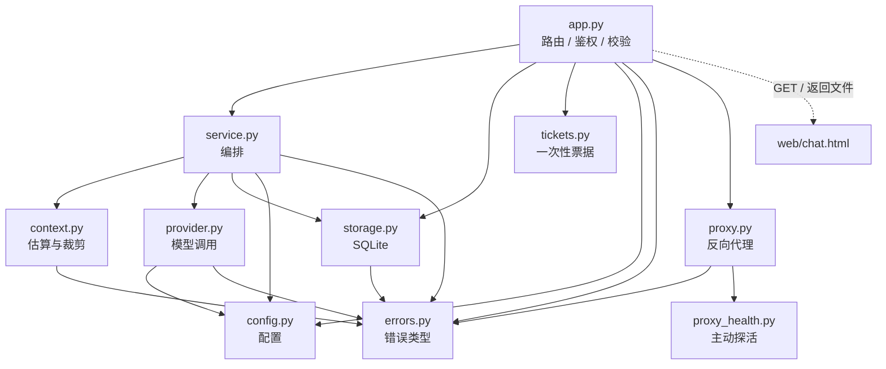
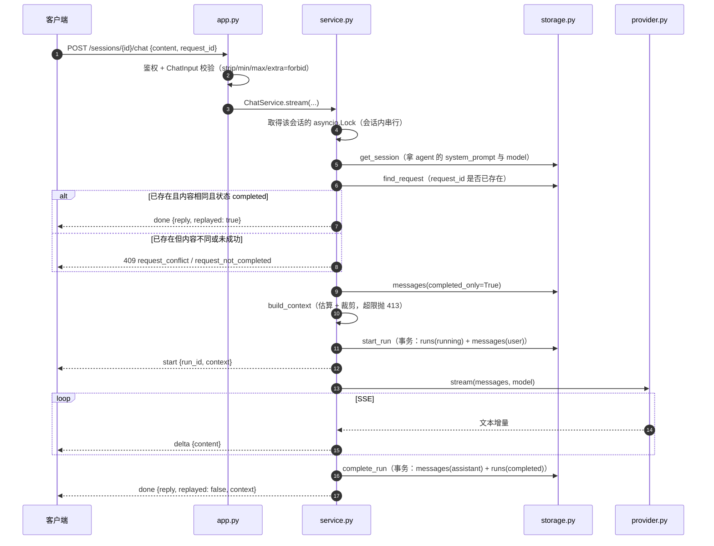
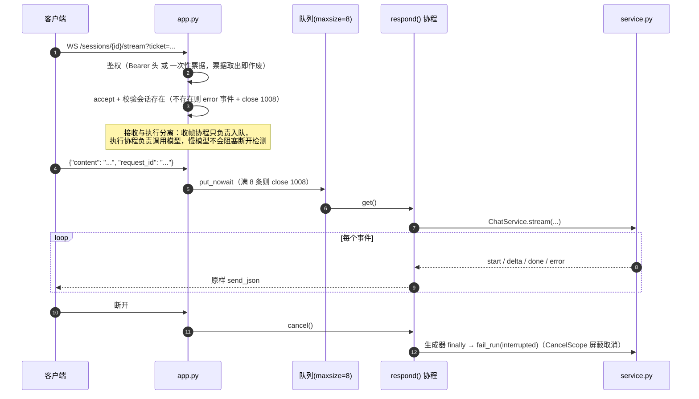
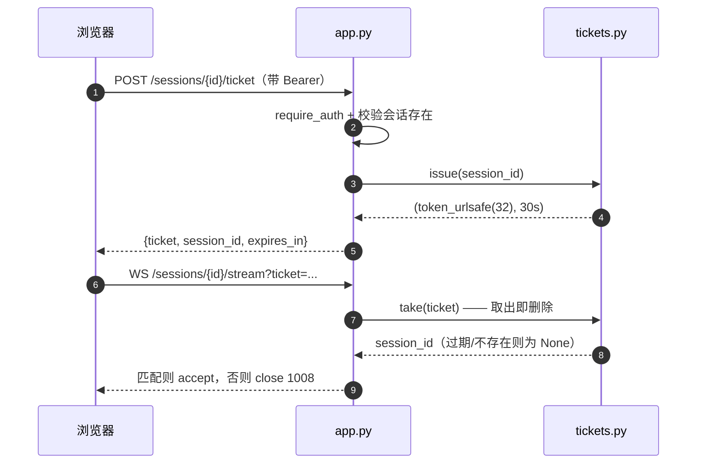
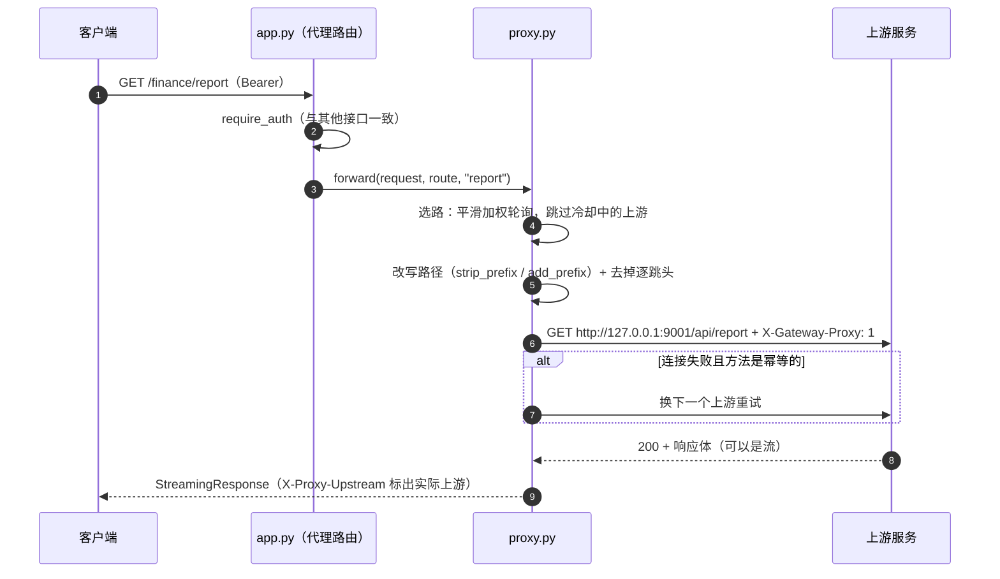
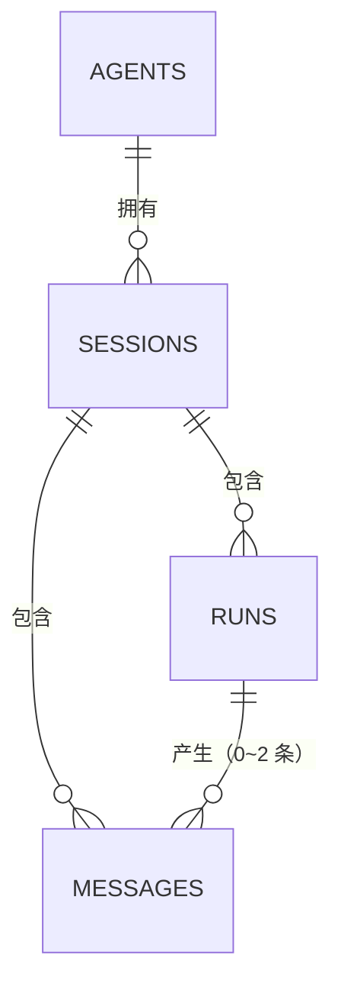
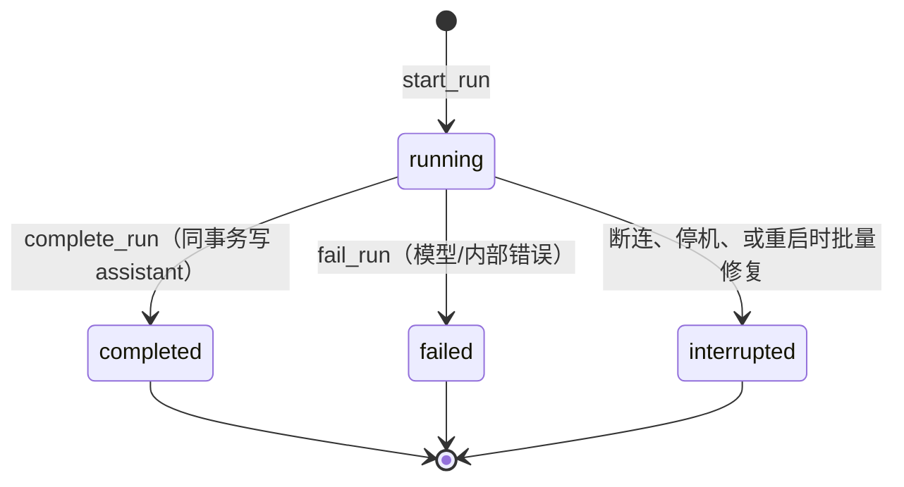

# 技术架构

本文描述 `ydd_python_gateway_origion` 的内部结构、并发模型、数据契约与可靠性边界。
面向"要改这个项目的人"，不是使用说明——安装与使用见 [README](../README.md)，接口契约见 [api.md](api.md)。

## 1. 定位与边界

一句话：**单进程、单数据库、面向个人与小规模集成的 Agent Gateway 基础版。**

对外提供三样东西：

1. HTTP JSON API —— 管理 Agent、会话、消息，发起提问（可等待完整回答）。
2. WebSocket 流式协议 —— 逐块推送模型输出。
3. 内置浏览器页 —— 自带鉴权准入，无需额外静态服务器。

内部维护四种实体：Agent（配置）、Session（会话）、Message（消息）、Run（一轮执行记录）。

**明确不做**（这些边界是有意的，不是尚未完成）：

| 不做 | 原因 |
| --- | --- |
| 模型工具调用 / 函数调用 | 会引入工具注册、执行沙箱、多轮工具循环，基础版只保留文本链路 |
| 多进程 / 多 worker | 会话锁与票据在进程内存中，SQLite 也只适合单写者 |
| 多用户 / 权限隔离 | 只有"一个共享 token"这一级鉴权 |
| 流事件重放 | WS 断开即丢弃该轮未完成内容；已完成的结果可通过 `request_id` 重放 |
| 历史压缩摘要 | 见 [design-decisions.md](design-decisions.md) ADR-006，当前只做预算裁剪 |
| OpenAI 入站兼容层 | 目前是自定义 API，不是 `/v1/chat/completions` 的替代品 |

规模假设：单机、并发会话数十个、单会话历史数千条以内。

## 2. 技术栈与运行要求

| 组件 | 用途 | `requirements.txt` 约束 | 本机实测版本 |
| --- | --- | --- | --- |
| Python | 运行环境 | ≥ 3.11（用到 `asyncio.timeout`、`aclosing`） | 3.14.0 |
| FastAPI | 路由、依赖注入、`/docs` | `>=0.115,<1` | 0.163.1 |
| Starlette | FastAPI 底座、`run_in_threadpool` | 随 FastAPI | 1.10.0 |
| Pydantic v2 | 请求体校验 | 随 FastAPI | 2.14.3 |
| uvicorn | ASGI 服务器 | `>=0.34,<1` | 0.54.0 |
| httpx | 调用模型服务（流式） | `>=0.28,<1` | 0.28.1 |
| websockets | uvicorn 的 WS 实现 + 示例客户端 | `>=14,<17` | 16.1.1 |
| anyio | 线程池、`CancelScope(shield=...)` | `>=4.1,<5` | 4.16.0 |
| python-dotenv | 读取 `.env` | `>=1,<2` | 1.2.4 |

> 注意：依赖里没有 `uvicorn[standard]`。uvicorn 只有在环境里能导入 `websockets`（或 `wsproto`）时才支持 WebSocket，
> 所以 `websockets` 既是示例客户端的依赖，也是服务端 `WS /sessions/{id}/stream` 能工作的前提。

## 3. 分层与模块

### 3.1 分层

```text
                HTTP 客户端            WebSocket 客户端          浏览器页面
                     │                        │                     │
┌────────────────────▼────────────────────────▼─────────────────────▼──────────┐
│ app.py          网络边界：路由、鉴权（Bearer / ticket）、输入校验、错误→状态码  │
├───────────────────────────────────────────────────────────────────────────────┤
│ service.py      业务编排：会话排队、取历史、预算裁剪、调用模型、落库、请求去重  │
│   ├── context.py    纯函数：token 估算与按预算裁剪（无 I/O）                     │
│   ├── provider.py   外部边界：SSE 解析、上游错误归一为 GatewayError             │
│   └── tickets.py    纯内存：WebSocket 一次性票据                                │
├───────────────────────────────────────────────────────────────────────────────┤
│ storage.py      持久化：SQLite 表结构与短事务（同步方法，由线程池调用）          │
├───────────────────────────────────────────────────────────────────────────────┤
│ SQLite（WAL）                                                                  │
└───────────────────────────────────────────────────────────────────────────────┘
```

依赖只向下：`app → service → {context, provider, tickets} + storage`。
`context.py` 和 `tickets.py` 不碰网络与数据库，所以能纯函数式地单测。

### 3.2 各模块职责

| 文件 | 职责 | 关键符号 | 不做的事 |
| --- | --- | --- | --- |
| `gateway/app.py` | 注册路由、鉴权、Pydantic 校验、把 `GatewayError` 映射为 JSON | `create_app`、`require_auth`、`accepts_ticket`、`chat`、`stream` | 不写业务逻辑、不直接拼 SQL |
| `gateway/service.py` | 唯一的编排入口，HTTP 与 WS 共用 | `ChatService.stream`（异步生成器） | 不解析 SSE、不拼 SQL |
| `gateway/context.py` | token 估算、按预算组装消息、超限报 413 | `estimate_tokens`、`build_context`、`PreparedContext` | 无 I/O、无状态 |
| `gateway/provider.py` | demo 回显、兼容 Chat Completions 的流式调用 | `ModelProvider.stream`、`_sse_data` | 不写库、不改历史 |
| `gateway/proxy.py` | 可选的反向代理：路由表、加权轮询、HTTP 流式转发、WebSocket 双向桥接 | `ProxyRoute`、`Proxy`、`load_routes` | 不解析上游语义、不做负载均衡以外的调度 |
| `gateway/proxy_health.py` | 反向代理的主动探活：周期探测、健康状态机、状态快照 | `HealthSettings`、`HealthMonitor` | 不碰转发路径，只改上游的 `healthy` 标记 |
| `gateway/access_log.py` | 访问日志中间件：路径、参数摘要、脱敏、trace_id | `AccessLogMiddleware`、`redact` | 不改请求/响应内容 |
| `gateway/logging_setup.py` | JSON 格式化、按类别/服务分文件、队列写盘、保留策略 | `LogSettings`、`setup_logging`、`DailyFileHandler` | 不决定"记什么"，只负责怎么记 |
| `gateway/audit.py` | 审计双写：`audit_log` 表 + `audit/` 文件；查询投影 | `AuditTrail` | 不改业务结果（写失败只记 ERROR） |
| `gateway/storage.py` | SQLite 表、迁移、索引、事务、查询 | `Store`、`MIGRATIONS` | 不 import `service`，不知道 HTTP |
| `gateway/tickets.py` | 一次性票据的签发与核销 | `TicketStore`、`TICKET_SECONDS` | 不持久化、不加锁（单事件循环） |
| `gateway/config.py` | 读环境变量 / `.env`，启动时校验 | `Settings`、`read_flag` | 不做运行时热更新 |
| `gateway/errors.py` | 统一业务错误 | `GatewayError(status_code, code, message)` | 不含 HTTP 细节 |
| `web/chat.html` | 浏览器页（单文件，无构建步骤） | `ask()`、`ensureSession()` | 不存密钥到服务端 |
| `run.py` | 启动入口、监听地址、对外监听保护 | `main` | 不含业务逻辑 |

### 3.3 依赖关系



## 4. 请求链路

### 4.1 一次 HTTP 提问（`POST /sessions/{id}/chat`）



要点：

- **先裁剪、后写记录**：413 发生在 `start_run` 之前，因此不产生运行记录，用户改短输入后可用**同一个** `request_id` 重试。
- **两处事务边界**：`start_run` 与 `complete_run` 各自原子；两者之间没有跨事务锁，模型调用期间不占用数据库写锁。
- **HTTP 只返回事件的终态**：`app.chat` 迭代生成器，遇到 `done` 直接作为 200 响应体返回，遇到 `error` 转成对应状态码。

### 4.2 一次 WebSocket 流式提问



要点：

- 一个连接可连续发多条消息，**执行是串行的**（单个 `respond()` 协程），服务端不会并发处理同一连接的多条请求。
- 每条消息也可以携带自己的 `request_id`；不传则由 Pydantic 默认值生成。
- 断开连接会取消正在执行的这一轮，并把 run 标记为 `interrupted`；排队但尚未开始的帧直接丢弃。

### 4.3 浏览器取票（为什么需要它）

浏览器原生 `WebSocket` 无法设置 `Authorization` 头，所以鉴权拆成两步：



`take()` 无论成功失败都会删除票据；用错会话也会作废（避免拿 A 的票反复试探 B）。

### 4.4 反向代理（可选能力）

`routes.json` 存在时，`create_app` 会为每个前缀注册同名的 HTTP 与 WebSocket 路由；文件不存在则完全不注册，内置接口零影响。



WebSocket 走同一套前缀，但握手方式不同：

```text
浏览器 --POST /proxy-ticket--> 网关（Bearer）--签发 ws:<路径> 票据
浏览器 --WS /finance/live?ticket=...--> 网关（核销票据，不转发 ticket）--> 上游 ws://127.0.0.1:9001/live
                                          ├── 客户端帧 → 上游
                                          └── 上游帧 → 客户端
```

关键点：

- **HTTP 用 `aiter_raw` 流式回写**，上游是 SSE 或大文件时不会被整体读进内存；
- **WS 用两条协程双向搬运**，任意一侧结束就收尾，并把上游的关闭码映射成 Starlette 允许的码（1006 之类改成 1011）；
- **子协议**：客户端请求的 `Sec-WebSocket-Protocol` 会透传给上游，再把上游选中的那个回给客户端（`accept(subprotocol=...)`）；
- **选路状态在内存里**：每个上游带 `current_weight` 与 `cooldown_until`；单进程单事件循环，不需要锁；
- **失败切换只发生在连接阶段**：WS 在 `accept` 之前可以换上游，`accept` 之后协议无法重放；HTTP 只在幂等方法（GET/HEAD/OPTIONS）上重放，且响应一旦开始就不再重试；
- **主动探活是独立模块**：`proxy_health.py` 的后台协程按最小间隔探测，只修改上游的 `healthy` 标记；
  4xx/405/501 视为存活，5xx 与连接失败才计数；全部不健康时仍兜底尝试，避免健康检查本身变成单点；
- **网关 token 与票据不外泄**：`Authorization` 不转发，`?ticket=` 也会从上游查询串里剔除；
- **回环识别**：代理给上游请求加 `X-Gateway-Proxy: 1`，如果进来的请求已经带这个头，直接 `508`；
- **目标只来自配置**，客户端无法指定 URL，因此不存在 SSRF 面。

## 5. 并发与一致性

### 5.1 线程模型

- 一个事件循环负责全部 HTTP/WS 与业务协程。
- SQLite 是同步的，所有调用经 `run_in_threadpool` 进入 anyio 线程池（默认最多 40 个并发令牌）。
- 模型调用是 `httpx.AsyncClient` 的异步流，不占线程。

### 5.2 会话内串行、会话间并行

```python
self.session_locks: WeakValueDictionary[str, asyncio.Lock] = WeakValueDictionary()
lock = self.session_locks.setdefault(session_id, asyncio.Lock())
async with lock:
    ...
```

- **为什么用弱引用字典**：锁只在有请求时才需要存在；会话数增长不会让内存无界增长。
- **为什么安全**：`setdefault` 在同一事件循环里没有 `await` 间隙，是原子的；进入 `async with` 后锁被局部变量强引用，不会中途被回收。
- **语义**：同一会话的请求严格按到达顺序执行，后一轮一定能看到前一轮已提交的答案；不同会话互不阻塞。
- **边界**：这把锁只在**单进程内**有效。多 worker 下同一会话会落在不同进程，串行保证失效——这是单进程约束的直接原因之一。

### 5.3 事务边界

| 操作 | 事务内容 | 说明 |
| --- | --- | --- |
| `start_run` | 插入 `runs(running)` + 插入 `messages(user)` | 两者必须同时成立，否则历史里会出现没有归属的提问 |
| `complete_run` | 插入 `messages(assistant)` + 更新 `runs(completed)` | 先提交再发 `done`，保证"收到 done 就一定能查到" |
| `fail_run` | 更新 `runs` 为 `failed` / `interrupted` | `WHERE status='running'` 守卫，重复调用是幂等的 |
| 删除会话 / 清空历史 | 先 messages、再 runs、最后 sessions | 外键要求按引用顺序删除 |

每次操作都新建连接（`sqlite3.connect` + `PRAGMA foreign_keys=ON`），因为 SQLite 连接默认不能跨线程复用；WAL 模式下读不会被写阻塞。

### 5.4 为什么只能单进程

| 进程内状态 | 多进程后的后果 |
| --- | --- |
| `session_locks` | 同一会话并发执行，历史顺序错乱 |
| `tickets` | 取票的进程与连 WS 的进程可能不同，随机 1008 |
| SQLite 单写者 | `database is locked` 概率上升（`timeout=5s` 后失败） |

`run.py` 固定 `workers=1`，README 也明确禁止两个实例共用一个数据库。

## 6. 数据模型

### 6.1 表结构

下面是列清单摘要（省略类型细节）；权威 DDL 见 `gateway/storage.py` 的 `Store.initialize()`。

```sql
schema_version(version INTEGER)   -- 只有一行，记录已执行到的迁移版本
agents(id TEXT PK, name, system_prompt, model, created_at)
sessions(id TEXT PK, agent_id → agents.id, title, created_at)
runs(id TEXT PK, session_id → sessions.id, request_id, input, status, reply,
     error_code, error_message, created_at, finished_at,
     UNIQUE(session_id, request_id))
messages(id INTEGER PK AUTOINCREMENT, session_id → sessions.id, run_id → runs.id,
         role CHECK IN ('user','assistant'), content, created_at)
CREATE INDEX messages_session ON messages(session_id, id)
audit_log(id TEXT PK, ts, trace_id, actor_type, actor_id, actor_name,
          action, target_type, target_id, result, reason, ip, details)   -- 迁移 v2
CREATE INDEX audit_log_ts ON audit_log(ts)
CREATE INDEX audit_log_action ON audit_log(action, ts)
```

迁移版本：v1 是初始表结构，v2 增加 `audit_log`。追加写法见 [development.md](development.md#45-新增表或字段)。

- 状态约束：`runs.status IN ('running','completed','failed','interrupted')`。
- `UNIQUE(session_id, request_id)` 是"去重"在数据库层的最后一道保障。
- 消息用自增整数主键，因此"写入顺序"就是 `id` 顺序，读取无需额外排序字段。

### 6.2 关系



### 6.3 运行状态机



终态不会再迁移：`fail_run` 带 `WHERE status='running'`，即使清理逻辑与正常完成竞争，也不会覆盖已完成的结果。

### 6.4 关键不变量

这些不变量被接口与裁剪逻辑依赖，改动时务必保住：

1. 每个 run **至多**一条 user 消息，且与 run 的创建同一事务。
2. assistant 消息**只在** run 变 `completed` 时写入，且两者同一事务。
3. 因此 `messages(completed_only=True)` 返回的历史严格是 `[user, assistant, user, assistant, ...]`，长度必为偶数。
4. `(session_id, request_id)` 唯一；同一编号不能承载不同内容。
5. 所有时间戳为 UTC ISO8601（`2026-11-17T15:30:00.123456+00:00`），所有 ID 为 `uuid4().hex`（默认 Agent 例外，固定为 `default`）。
6. 失败轮的 user 消息**保留**在 `messages` 表（可查询、可审计），但不会进入下一轮的模型上下文。

第 6 条是有意的取舍：宁可让历史表里留一条"没有回答的提问"，也不要在用户重试时抹掉审计痕迹。代价是这些记录对上下文没有贡献，只能靠 `run_status` 区分。

### 6.5 建表、迁移与启动修复

`Store.initialize()` 每次启动依次做三件事：

1. **按版本迁移**：`schema_version` 表记录当前版本（没有这张表的旧库视为版本 0），
   `MIGRATIONS` 里版本号大于当前值的条目会被逐条执行，然后写回新版本。
   第 1 版的语句全部是 `IF NOT EXISTS`，所以旧库升级不会重建或清空数据。
2. **修复遗留运行**：把上一次进程遗留的 `running` 记录批量改成 `interrupted`（"服务重启，本轮已中断"）。
3. **补齐默认 Agent**：`INSERT OR IGNORE`，并用当前 `MODEL_NAME` 覆盖它的 `model`。

加表或加列时只在 `MIGRATIONS` **末尾追加**一个版本，已发布的条目一律不改——旧库正是靠它们逐级升级到最新版本的。

第 2 条保证：进程崩溃不会留下永久 `running` 的记录卡住后续删除/清空操作（那些操作会检查 `running`）。

## 7. 上下文预算

公式与算法见 [README 的"上下文预算与裁剪"](../README.md#上下文预算与裁剪)，这里记录实现层面的约定：

```text
budget      = MODEL_CONTEXT_TOKENS − MODEL_MAX_TOKENS − SAFETY_TOKENS(128)
fixed       = tokens(system) + tokens(user)
notice      = tokens("（较早的 N 条对话已省略…）")   ← 无论是否省略都预留
remaining   = budget − fixed − notice
```

- 从最旧的一轮开始整对丢弃，直到 `remaining` 容得下；遇到放不下的一轮立即停止（更旧的只会更长）。
- 丢弃后插入一条 `role=system` 的提示，让模型知道前文有缺失。
- `remaining < 0`（连 system + 当前提问都放不下）→ `413 context_too_large`。
- 估算：宽字符 1 token/字，其余 3 字符/token 向上取整，每条消息 +4 框架开销。**偏保守**是刻意的。
- 不变量：`estimated_tokens <= budget_tokens`（单测断言）；数据库中的历史不被修改。

因为 `Settings` 保证 `context_tokens ≥ max_tokens + 256`，所以 `budget ≥ 128` 恒成立，不会出现"配置合法但预算为负"的情况。

## 8. 认证与票据

### 8.1 信任边界

```text
[浏览器/客户端] --token 或 ticket--> [Gateway] --MODEL_API_KEY--> [模型服务]
        ↑                                  ↑
   用户可见的只有 Gateway token      模型密钥只存在于服务端进程
```

两种准入方式（`legacy` 模式）：

| 场景 | 凭证 | 校验点 |
| --- | --- | --- |
| HTTP 业务接口 | `Authorization: Bearer <GATEWAY_TOKEN>` | `require_auth`（依赖注入） |
| WS（Python 等客户端） | 同上，握手头 | `token_matches` / `legacy_open` |
| WS（浏览器） | `?ticket=<一次性票据>` | `websocket_principal`（取出即作废） |

- 比较用 `secrets.compare_digest`，避免按字节提前返回。
- `GATEWAY_TOKEN` 为空且为 `legacy` 模式表示**关闭校验**，仅适合本机；`run.py` 在监听非回环地址时要求本地认证或 token。
- 内置页面与 `/health` 不需要凭据（页面只是外壳，`/health` 只回 `provider` 和 `auth_required`）。

### 8.1b 本地认证（`GATEWAY_AUTH_MODE=local`）

多人使用时改用本地账号：

```text
浏览器 → POST /login（表单）→ 校验 scrypt 哈希
       → 生成 32 字节随机 token，DB 只存 SHA-256
       → Set-Cookie: ydd_session（HttpOnly; SameSite=Lax; Secure?）
       → 后续请求：Cookie → 会话行 → 用户（检查吊销、空闲/绝对过期）
脚本   → Authorization: Bearer <GATEWAY_TOKEN>（映射为管理员，过渡期兼容）
```

- **密码**：stdlib `hashlib.scrypt`（n=2^14, r=8, p=1，16 字节盐）；用户不存在时也跑一次哈希防枚举。
- **会话**：不透明 token，服务端可吊销；登出/重置密码立即失效；`last_seen_at` 最多每 60 秒写一次。
- **CSRF**：Cookie 认证的非幂等请求校验 `Origin` / `Sec-Fetch-Site`（同源放行，跨站 `403 csrf_rejected`）；Bearer 不受影响。
- **限速**：按 `(IP, 用户名)` 计数，超过阈值锁定；失败写入审计。
- 认证顺序：Cookie 会话 → 共享 token → API Key；WS 额外保留票据（浏览器取票仍可用，但 Cookie 已足够）。

### 8.1c API Key（机器身份）

```text
明文：ydd_<16 位 id>_<32 字节 secret>
存储：id + sha256(secret) + 前 8 位前缀（用于列表展示）
校验：按 id 查行 → 常量时间比较哈希 → 检查撤销/过期 → 读取 scopes
```

- scope 按资源检查：`sessions`（会话/消息/聊天/WS）、`agents`、`audit`、`proxy`；
- API Key 不能管理 API Key，也不能默认读审计；
- `last_used_at` 最多每 60 秒更新一次，避免每个请求一个写事务；
- 管理员可随时撤销；数据库泄露不会直接得到可用的 Key（只有哈希）。

### 8.2 票据生命周期

```text
签发（需 Bearer） → 30 秒内 → 首次 WS 握手核销 → 立即从内存删除
                 ↘ 过期 → take() 返回 None
                 ↘ 用错会话 → 同样作废
```

票据只存在内存：重启即失效，页面重新取票；也因此禁止多 worker。

已知暴露面：票据出现在 WS 查询串里，会进入 uvicorn 访问日志。一次性 + 30 秒把窗口压到很小，但长期留存日志的环境应加 TLS 反向代理并收紧日志。

## 9. 错误模型

### 9.1 一个错误源，两种载体

业务层只抛 `GatewayError(status_code, code, message)`。`error` 对象里**只放 `code` 和 `message`**，
其余信息（会话、请求、运行编号，以及状态码）都放在外层：

| 载体 | 形状 |
| --- | --- |
| HTTP | `{"error": {"code", "message"}}`，可选外层 `session_id` / `request_id` / `run_id`；状态码由状态行表达 |
| WebSocket | `{"type": "error", "status": <int>, "session_id": ..., "request_id": ..., "run_id": ..., "error": {"code", "message"}}` |

不存在的标识符**直接省略**，不写 `null`。于是客户端只有一条规则：

- 错误码看 `error.code`（两种载体一致）；
- HTTP 看状态行，WebSocket 看 `status` 字段。

### 9.2 谁负责转换

```text
路由 / 依赖 / 存储层抛出的 GatewayError  → app.py 的异常处理器 → {"error": {...}} + 状态码
service 生成器内的 GatewayError         → error 事件（含 status 与已存在的编号）
    ├── HTTP：app.chat 去掉 type/status 后作为 {"error": ...} 返回
    └── WS：原样 send_json
未预期异常
    ├── HTTP：不捕获 → 500（FastAPI 默认）
    └── WS：先发 500 internal_error 事件，再 close 1011
```

### 9.3 边界情况

| 情况 | 处理 |
| --- | --- |
| WS 握手阶段鉴权失败 | 尚未 `accept()`，无法发送事件，只能 `close 1008` |
| WS 握手阶段会话不存在 | 先发 `404 session_not_found` 事件，再 `close 1008` |
| WS 帧不是合法 JSON | 发 `422 invalid_request` 事件（没有 `request_id`），连接保持可用 |
| 413 超预算 | 事件里没有 `run_id`——这一轮没有写运行记录 |

## 10. 可靠性

### 10.1 超时层级

| 层级 | 参数 | 覆盖范围 | 触发后 |
| --- | --- | --- | --- |
| httpx 超时 | `MODEL_TIMEOUT_SECONDS` | 单次连接、单次读等待 | `504 model_timeout` |
| `asyncio.timeout` | `MODEL_TIMEOUT_SECONDS` | **整轮**生成 | `504 model_timeout` |
| 会话排队 | 无上限 | 等同一会话的前一轮 | 不计入任何超时（文档已声明） |
| WS 待处理队列 | 8 条 | 单连接未开始的消息 | `close 1008` |
| WS 文本帧 | 64 KiB | 单帧 | `close 1009` |
| 优雅关停 | 10 秒 | 服务停止时等待在途请求 | 超时后强制取消 |

httpx 的超时管"一段时间没有数据就断"，`asyncio.timeout` 管"这一轮总时长"——两层都必要：上游可能持续发送心跳/空事件，单靠读超时永远触发不了。

### 10.2 失败与中断

| 情况 | 运行记录 | 已收到的部分文本 | 下一轮上下文 |
| --- | --- | --- | --- |
| 模型报错 / 超时 / 空回答 / 流提前结束 | `failed` | 丢弃，不写历史 | 不含这一轮 |
| WS 断开 / 服务停机 | `interrupted` | 丢弃 | 不含这一轮 |
| 进程崩溃 | 下次启动改为 `interrupted` | 丢弃 | 不含这一轮 |
| 413 超预算 | **不建记录** | 无 | 不变，可用同一 `request_id` 重试 |

### 10.3 幂等与去重

- 同一 `(session_id, request_id)` + 相同内容 + 已 `completed` → 直接返回已有答案（`replayed: true`），不再调用模型。
- 相同编号但内容不同 → `409 request_conflict`；编号已有失败/中断记录 → `409 request_not_completed`。
- **不承诺 exactly-once**：去重依赖"已提交的运行记录"，发生在 `start_run` 之前的崩溃不会留下记录。
  因此客户端在超时后应先查 `GET /sessions/{id}/requests/{request_id}`，而不是换个编号重发。

## 11. 可观测性

日志由 `logging_setup.py` 统一接管：每条记录一行 JSON，经队列写到按类别/服务划分的文件，
访问日志由 `access_log.py` 的纯 ASGI 中间件产生。详细字段与规则见
[README 的"日志与审计"一节](../README.md#11-日志与审计)，这里记录实现层面的约定：

| 位置 | 类别 | 记录内容 | 刻意不记录 |
| --- | --- | --- | --- |
| 访问中间件 | `access` | 方法、路径、路由模板、状态、耗时、trace_id、**脱敏后的参数** | 完整请求体、Cookie、Authorization |
| `service.stream` 裁剪 | `app` | 会话 id、省略条数、估算/预算 token | 消息内容 |
| `service.stream` 未知异常 | `app` | 异常类型名 | 异常文本 |
| `proxy.py` 冷却 | `proxy` | 前缀、上游、原因 | 请求内容 |
| `proxy_health.py` | `proxy` | 判死/恢复、探活循环异常 | —— |
| 被代理服务 | `service:<name>` | 该前缀的转发访问日志 | —— |
| 审计 | `audit` | 变更事件（谁、做了什么、结果、来源 IP、trace_id） | 对话正文 |
| uvicorn | `app` | 启动、关停、未预期错误 | —— |

关键实现：

- **纯 ASGI 中间件**：只旁路复制请求体前 `PARAM_MAX_BYTES` 字节，不重新构造 Request，因此不影响下游解析；
- **trace_id 在产出线程抓取**：`TraceIdFilter` 把 contextvar 写进 `LogRecord`，因为格式化发生在队列监听线程；
- **队列写盘**：`QueueHandler + QueueListener`，磁盘抖动不阻塞事件循环；
- **按类别路由**：`LogRouter` 依 logger 名分发，服务类日志按 `gateway.service.<name>` 落到 `services/<name>/`；
- **文件生命周期**：`DailyFileHandler` 按天切分、超过 `GATEWAY_LOG_MAX_BYTES` 追加序号、按保留天数清理旧文件；
- **关闭时**：`LoggingRuntime.stop()` 停监听线程并关闭句柄，避免 Windows 上文件被占住。

可继续增强：`/metrics`（Prometheus）、OpenTelemetry trace——属于独立一层，不在当前范围。

## 12. 性能与容量

单轮请求的数据库操作（每次都是新连接上的短事务）：

```text
get_session → find_request → messages → start_run → complete_run/fail_run   ≈ 5~6 次
```

- 历史是**全量读取后在内存裁剪**（O(n)），单会话数千条消息仍是毫秒级。
- 单条消息上限 32,000 字符；`content` 需去除首尾空白后非空。
- 消息写入是同步的，但只在 `start_run` / `complete_run` 两次，模型生成期间不占用写锁。
- WAL 允许读并发，写串行；`timeout=5s` 是写冲突时的等待上限。

粗略结论：个人使用、几十个并发会话完全够用；不适合当多租户或高吞吐服务。

## 13. 已知限制汇总

| 限制 | 影响 | 触发条件 |
| --- | --- | --- |
| 单进程 | 不能水平扩展 | 任何多实例部署 |
| 单 token | 无法区分用户 | 多人共用 |
| 无 TLS | token 明文过网 | 跨不可信网络 |
| 票据进 URL | 可能被日志留存 | 长期保存访问日志 |
| 迁移只进不退 | 升级后没有回滚脚本 | 需要降级时得手工处理 |
| 历史不压缩 | 早期对话只能被丢弃 | 超预算 |
| 列表无缓存语义 | 无 ETag / 条件请求，每次全量返回 | 高频轮询列表 |
| 无工具调用 | 只能文本问答 | 需要函数调用 |
| 代理只覆盖 HTTP/WS | gRPC、TCP 等协议不能经网关转发 | 需要代理非 HTTP 服务 |
| 代理无粘性 / 服务发现 | 无法保证同一客户端固定到同一上游 | 上游持有本地状态（会话、缓存） |
| 代理 WS 票据需页面配合 | 被代理页面要自己调 `/proxy-ticket` 取票 | 浏览器直连被代理的实时服务 |
